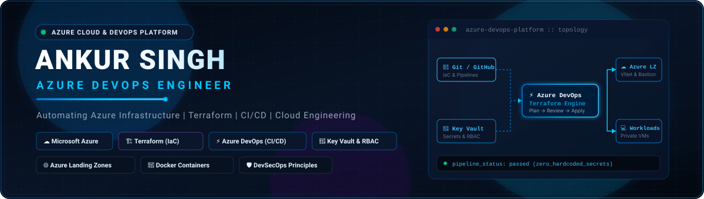
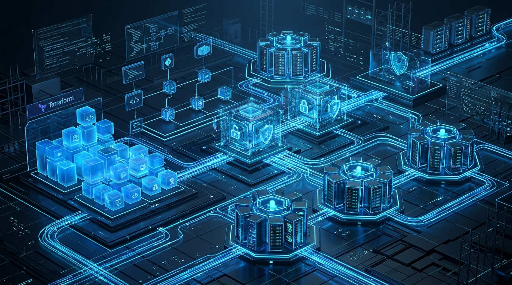
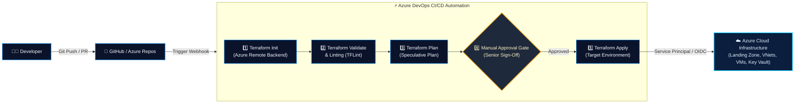
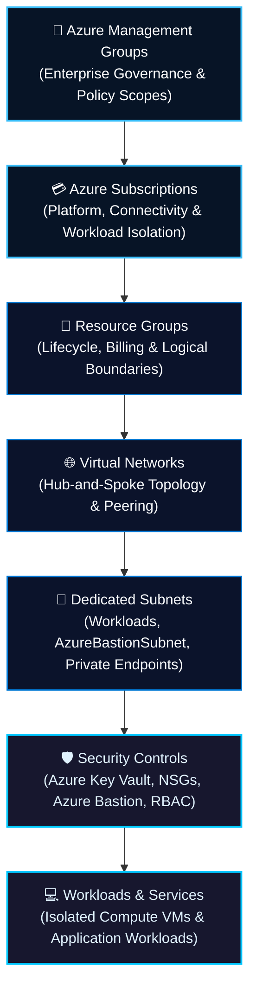
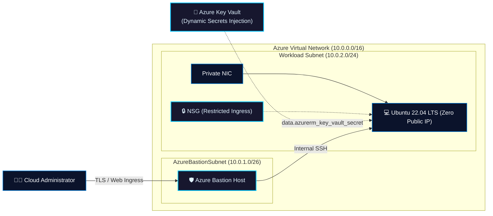
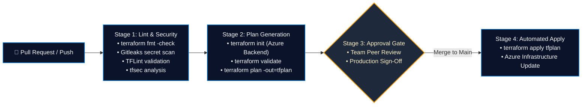
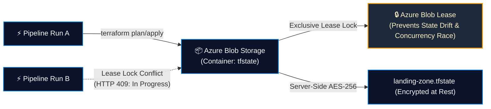
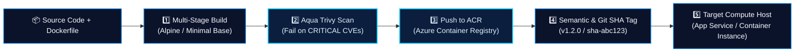

<div align="center">

  <!-- ================= HERO BANNER ================= -->
  <a href="https://github.com/ankursinghdevops">
    
  </a>

  <br/><br/>

  <!-- ================= STATUS BADGES ================= -->
  <p align="center">
    
    
    
    
    
    <a href="https://linkedin.com/in/YOUR-LINKEDIN-HANDLE" target="_blank">
      
    </a>
  </p>

  <!-- ================= QUICK NAVIGATION ================= -->
  <p align="center">
    <b>
      <a href="#-about-me">About Me</a> &nbsp;•&nbsp;
      <a href="#-core-technical-competencies">Tech Stack</a> &nbsp;•&nbsp;
      <a href="#-architecture-workflows">Architecture Workflows</a> &nbsp;•&nbsp;
      <a href="#-featured-projects">Featured Projects</a> &nbsp;•&nbsp;
      <a href="#-github-metrics--activity">GitHub Activity</a> &nbsp;•&nbsp;
      <a href="#-connect--collaborate">Contact</a>
    </b>
  </p>

</div>

---

## 👨‍💻 About Me

I am an **Azure DevOps Engineer** with **around 3 years of hands-on experience** architecting, provisioning, and automating cloud infrastructure on **Microsoft Azure**. My core focus is building reliable, repeatable, and secure cloud environments through **Terraform (Infrastructure as Code)** and automated **CI/CD pipelines**.

### What I Do:
- **Cloud Infrastructure Provisioning:** Architecting modular Azure infrastructure spanning Virtual Networks (VNets), dedicated subnets, Azure Bastion hosts, network security groups (NSGs), and isolated compute resources.
- **Infrastructure as Code (IaC):** Designing DRY, scalable Terraform child and root modules utilizing dynamic `for_each` resource maps, strict variable typing, and remote state governance.
- **CI/CD Automation:** Building robust, multi-stage pipelines in **Azure DevOps (YAML)** and **GitHub Actions** with automated formatting, linting, policy validation, speculative plan generation, and gated production rollouts.
- **Containerization:** Containerizing applications using **Docker** with multi-stage builds, layer caching, vulnerability scanning, and integration with **Azure Container Registry (ACR)**.
- **Cloud Security & DevSecOps:** Enforcing the Principle of Least Privilege, role-based access control (**Azure RBAC**), **Managed Identities**, zero-hardcoded secrets via **Azure Key Vault**, and shift-left scanning with **TFLint**, **tfsec**, and **Gitleaks**.
- **Troubleshooting & Observability:** Diagnosing deployment bottlenecks, network routing anomalies, pipeline failures, and infrastructure drift to maintain high platform availability.

> **Core Philosophy:** *Treat infrastructure as software: version-controlled, modular, tested before deployment, and deployed with zero manual intervention.*

<br/>

<div align="center">
  
</div>

---

## 🛠️ Core Technical Competencies

<div align="center">

| Domain | Technologies & Tools |
| :--- | :--- |
| **Cloud Platform** |      |
| **Infrastructure as Code** |     |
| **CI / CD & Automation** |      |
| **Containers & Registries** |    |
| **Cloud Security & DevSecOps** |       |
| **OS & Scripting** |    |
| **Foundational Knowledge** |  *(Conceptual understanding of pods, services, deployments, and cluster architecture; limited project exposure)* |

</div>

---

## 🏛️ Architecture Workflows

The following diagrams illustrate the core architectural and automation patterns I implement across cloud infrastructure, delivery pipelines, and enterprise network design.

### 1. Terraform Infrastructure Provisioning Workflow
*Automating repeatable, declarative infrastructure rollouts through structured version control and gated pipeline stages:*



---

### 2. CI/CD Application & Container Workflow
*End-to-end continuous integration and deployment pipeline ensuring artifact verification before deployment:*

```mermaid
flowchart LR
    Commit["💻 Code Commit\n(Feature / Release)"] --> Build["🔨 Build & Compile\n(Application Packages)"]
    Build --> Val["🔍 Quality Gates\n(Static Analysis & Secrets Check)"]
    Val --> Docker["🐳 Build Docker Image\n(Multi-Stage Dockerfile)"]
    Docker --> ACR["📦 Container Registry\n(Azure ACR / Tagged Release)"]
    ACR --> Deploy["🚀 Deployment\n(Container Host / Service)"]
    Deploy --> Verify["✅ Health Verification\n(Smoke Tests & Health Checks)"]

    classDef default fill:#0B132B,stroke:#0078D4,stroke-width:1.5px,color:#F8FAFC;
    classDef highlight fill:#0C1E3D,stroke:#00C7FF,stroke-width:2px,color:#E0F2FE;
    class Commit,Docker,ACR,Deploy highlight;
```



---

### 3. Azure Enterprise Landing Zone Topology
*Hierarchical cloud governance framework implementing isolation, perimeter defense, and zero-trust controls:*



---

## 🚀 Featured Projects

### 1. Azure Enterprise Secure Landing Zone (Terraform)
[](https://github.com/ankursinghdevops/Azure-Enterprise-Secure-Landing-Zone-Terraform)
[](https://github.com/ankursinghdevops/Azure-Enterprise-Secure-Landing-Zone-Terraform)
[](https://github.com/ankursinghdevops/Azure-Enterprise-Secure-Landing-Zone-Terraform)
[](https://github.com/ankursinghdevops/Azure-Enterprise-Secure-Landing-Zone-Terraform)
[](https://github.com/ankursinghdevops/Azure-Enterprise-Secure-Landing-Zone-Terraform)

**Description:** An enterprise-grade, modular Azure Landing Zone engineered with Terraform. Implements a secure network topology with isolated compute workloads, administrative ingress guarded by Azure Bastion, and dynamic runtime secret injection from Azure Key Vault without storing credentials in source code.



**Key Architectural Features:**
- **Zero Public IP Exposure for Compute:** All Ubuntu 22.04 LTS virtual machines reside entirely in private subnets with no internet-facing public IPs.
- **Dynamic Secret Injection:** Administrative credentials (`admin_username` & `admin_password`) are injected dynamically via Terraform data sources directly from **Azure Key Vault**.
- **Secure Management Access:** Browser and CLI access handled strictly over SSL/TLS via **Azure Bastion Host**, eliminating exposed SSH port 22.
- **Modular Scalability:** Clean separation between child modules (`module/`) and root environments (`environment/preprod`) utilizing `for_each` map iteration for deterministic deployments.

---

### 2. Azure DevOps Terraform CI/CD Automation Pipeline
[](https://github.com/ankursinghdevops/new-pipeline-LZ)
[](https://github.com/ankursinghdevops/new-pipeline-LZ)
[](https://github.com/ankursinghdevops/new-pipeline-LZ)
[](https://github.com/ankursinghdevops/new-pipeline-LZ)

**Description:** A multi-stage continuous integration and delivery pipeline automating the linting, validation, security analysis, planning, and rollout of Terraform infrastructure code across environment stages (`preprod` and `prod`).



**Key Architectural Features:**
- **Automated Validation Gates:** Runs `terraform fmt -check`, `terraform init`, and `terraform validate` on every pull request.
- **Shift-Left Security Scanning:** Integrated pre-deployment vulnerability and secret detection using **Gitleaks** (preventing committed tokens), **TFLint** (rule verification), and **tfsec** (IaC security flaws).
- **Speculative Plan Generation:** Generates execution plans (`terraform plan`) for team review during code review workflows.
- **Protected Environment Deployments:** Restricts `terraform apply` execution strictly to merges into the primary branch with required review approvals.

---

### 3. Azure Remote Terraform State Management & State Locking
[](#)
[](#)
[](#)
[](#)

**Description:** Production-grade Terraform state management architecture designed to eliminate local state files, guarantee team concurrency protection, and protect sensitive state data through Azure native security controls.



**Key Architectural Features:**
- **Centralized Azure Storage Backend:** Stores Terraform state in dedicated Azure Blob Storage containers, removing sensitive state data from local workstations and version control.
- **Native Concurrency Locking:** Leverages Azure Blob Storage automatic lease locking to prevent simultaneous pipeline executions from corrupting infrastructure state.
- **Encryption in Transit & At Rest:** Enforces TLS 1.2+ for all backend communication and transparent server-side AES-256 data encryption.
- **Environment Isolation:** Segregates environment states (`dev`, `preprod`, `prod`) into separate storage containers or state keys with fine-grained **Azure RBAC** role assignments.

```hcl
# Production-ready Azure Blob Storage remote backend configuration
terraform {
  backend "azurerm" {
    resource_group_name  = "rg-terraform-state-mgmt"
    storage_account_name = "sttfstatelz001"
    container_name       = "tfstate"
    key                  = "landing-zone.preprod.tfstate"
    use_azuread_auth     = true # Uses Entra ID / RBAC authentication
  }
}
```

---

### 4. Docker Build & Deployment Automation Pipeline
[](#)
[](#)
[](#)
[](#)

**Description:** Standardized containerization and deployment workflow implementing multi-stage Docker builds, image hardening, vulnerability scanning, and automated publishing to Azure Container Registry (ACR).



**Key Architectural Features:**
- **Multi-Stage Dockerfile Optimization:** Separates build-time dependencies from minimal runtime environments, significantly shrinking image attack surface and deployment footprint.
- **Automated Container Security Auditing:** Integrates automated vulnerability scanning (Aqua Trivy) to detect CVEs before pushing images to the registry.
- **Traceable Tagging Strategy:** Implements deterministic tagging schemes incorporating semantic versions and Git commit SHAs for instant rollback capabilities.
- **Least-Privilege Container Runtime:** Configures non-root user execution inside container definitions, adhering to container security baselines.

---

## 📊 GitHub Metrics & Activity

<div align="center">

  <table border="0">
    <tr>
      <td align="center" width="50%">
        <a href="https://github.com/ankursinghdevops">
          
        </a>
      </td>
      <td align="center" width="50%">
        <a href="https://github.com/ankursinghdevops">
          
        </a>
      </td>
    </tr>
    <tr>
      <td align="center" colspan="2">
        <a href="https://github.com/ankursinghdevops">
          
        </a>
      </td>
    </tr>
  </table>

</div>

---

## 🤝 Connect & Collaborate

I am always interested in discussing **Azure Cloud Architecture**, **Terraform Automation**, **CI/CD Best Practices**, and **DevOps Engineering**. Feel free to connect or reach out directly!

<div align="center">

| Platform | Channel | Link |
| :--- | :--- | :--- |
| **LinkedIn** | Professional Profile | [Connect on LinkedIn](https://linkedin.com/in/YOUR-LINKEDIN-HANDLE) *(Replace with your LinkedIn handle)* |
| **Email** | Direct Inquiries | [ankursingh571999@gmail.com](mailto:ankursingh571999@gmail.com) |
| **GitHub** | Technical Portfolio | [@ankursinghdevops](https://github.com/ankursinghdevops) |
| **Focus Area** | Core Expertise | Azure Infrastructure Provisioning, Terraform IaC, YAML Pipelines |

</div>

<br/>

<div align="center">
  <sub>Designed with precision for modern cloud engineering. Built with Microsoft Azure &amp; HashiCorp Terraform standards.</sub>
</div>